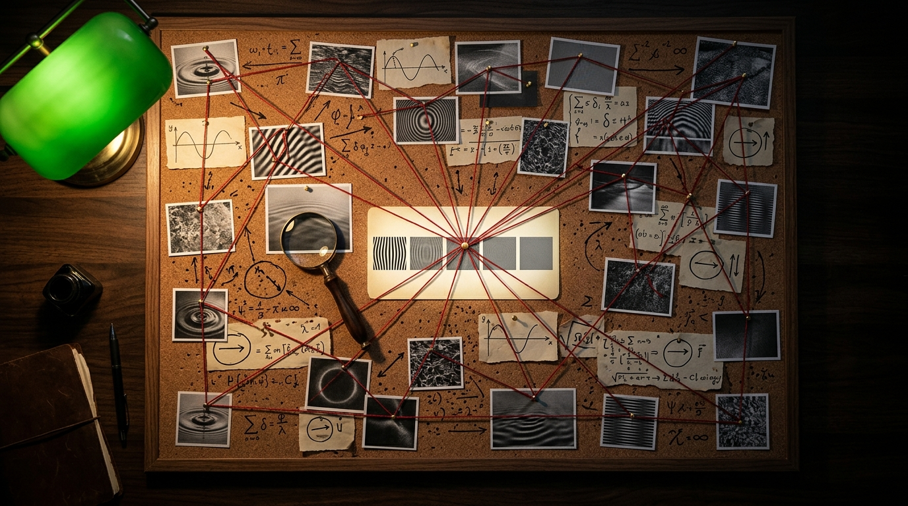

# Evidence Adds Up to a Fact

*Quest for Entropy #19: how does a quantum world of possibilities give us one definite answer? A toy model of measurement's deepest mystery.*

## The question

> The Paper: [paper/the-iceberg-model.md](https://github.com/questforentropy/iceberg-model/blob/main/paper/the-iceberg-model.md)

This diary has met a few mysteries by now. The queen of them is the measurement problem. This time, I wanted to get past the word “collapse” and picture what might actually be happening.

A free particle is described by a wave [wavefunction]. In [Developed, Not Erased](https://questforentropy.com/p/developed-not-erased), the wave spread across two arms [superposition]. It was still one particle: on the toy, one table [state vector] with two lines, one per arm.

Then that wave meets another, the marker M. Their meeting pairs each arm with a different marker state [entanglement]. From then on, we need one joint table to describe them. Nothing has been read, and no arm selected. Like a twist of a Rubik's cube, the meeting rearranges which pieces can meet. Both arm components remain, but their different marker labels keep them from interfering in P's results alone. The familiar stripes [interference pattern] disappear.

I picture particles as the heads of a hydra: the heads are what we see, the shared wave is the body beneath. That is a picture, not a result.

So far, I can follow the trick. Then the particle hits a detector, the textbook says the wave function collapses, and we have one answer. But a detector is made of particles too. What does its first particle do that our marker does not?

In [Two to Sign Is the Norm](https://questforentropy.com/p/two-to-sign-is-the-norm), we proposed a settlement: two books sign one answer. But they signed because I told them to. I wanted to look inside that agreement.

As a software architect, I kept coming back to a familiar idea: a **consensus mechanism**. In distributed systems, machines exchange information to agree on a shared record. My Iceberg Model asks whether the universe might be the largest distributed system of all. Could a crowd of particles arrive at an agreement and secure it through their meetings, rather as a blockchain secures a record? That was the intuition I wanted to explore.

We gave ourselves three jobs: arrive at one answer, choose it with the right odds, and leave a record that lasts. We started by exploring them in separate toys. Getting all three to work in one mechanism is still the open challenge.

## The toy

We began with a much smaller crowd than a detector: one travelling particle P, a marker M [which-path marker], and two witnesses that could carry a trace away [environment fragments]. Four particles were enough to let a clue escape, but few enough that we could follow every meeting and try to run it backwards.

The table holds little arrows [complex probability amplitudes]. When alternatives meet again, arrows pointing together reinforce one another; arrows pointing opposite ways can cancel. A turn [unitary transformation] changes how they line up. That is the wave arithmetic underneath the pictures.

For the marker, imagine a tiny memory. Our meeting flips its label in the right-arm part of the wave and leaves it alone in the left-arm part [CNOT]. We have attached a different label to each possibility. Both remain; neither has won. M now carries a clue about the arm [which-path information]. We will need that distinction throughout: carrying a clue is not yet choosing an answer.

## The run

### Develop the picture, or undo the meeting?

First, we had to keep two experiments apart. Last episode started with a pile of results already recorded. We turned and read M, then used its answer to sort P's saved results into two groups. Each showed stripes, with one group's bright parts filling the other's dark parts. Put the groups back together and the stripes disappeared. No recorded hit moved. That is how we developed the picture in the [delayed-choice quantum eraser](https://arxiv.org/abs/quant-ph/9903047).

This time we asked: could we undo the marking itself, **before P is detected**? Let P and M meet, then reverse that joint meeting, acting on both together.

On this toy the undo is simple to picture. Flip M's label once more in the right-arm component, and it is back where it started. In the left-arm component it never changed. M now has the same label alongside both possibilities, so it no longer distinguishes them. Provided no clue escaped elsewhere, P and M are no longer entangled.

Now bring the arms together and detect P. The stripes return across repeated runs, in the whole pile of results, without sorting. We changed what happens before detection; we changed no earlier hit.

That gave us our first foothold. We could reverse the meeting while its trace was still within reach. It takes control of the joint P–M interaction; turning M alone cannot do it.

[Try the joint meeting and its undo before detection.](https://questforentropy.com/p/evidence-adds-up/bench#room1)

### Now let the clue escape

Then we made the undo harder. Before trying it, we let M meet a witness, and then another. Each witness picked up a trace. Both arm possibilities were still there, but now each had its own witness states attached.

This time, reversing P's meeting with M did not bring the stripes back. The witnesses still carried labels that distinguished the arms [decoherence]. We had reversed the original meeting, but left its traces elsewhere.

I picture two people making a verbal agreement, then telling witnesses. The pair can change their story, but the witnesses still remember. To return to a world where that conversation left no trace, we would have to reach those memories too. The quantum undo demands precise physical reversal, but this picture helped me see what had escaped our hands.

On the toy, one witness left holding a complete arm label was enough to block the unsorted fringe. Reach every witness and undo the meetings, last first, and it returned. We were still following both possibilities through the shared wave. Nothing in this experiment had selected one of them.

Next we weakened the witnesses' clues. Their two possible states now overlapped: a witness could only partly tell the arms apart. The stripes faded gradually. In one example, leaving one witness untouched let us recover about 71 percent of their original contrast [interference visibility]. Leaving two recovered half. Each witness had met M directly, starting clean and independent; each took another fraction of the recoverable contrast away. [Other arrangements leave different traces.](https://questforentropy.com/p/evidence-adds-up/bench#room5)

That was a useful change in perspective. I had been looking for a special act performed by the detector's first particle. Now I could picture that particle behaving just like our marker, while the crowd carried the trace beyond our reach. [“Permanent” began to mean something practical](https://questforentropy.com/p/evidence-adds-up/bench#room4): how much of the world would we have to get our hands on to put it back?

### But who chose the answer?

But we had a problem. We could make the stripes disappear without ever choosing an answer. Both alternatives survived every copying calculation.

So we returned to #17. What if its two signatures were the successful end of many small attempts? We opened that agreement into a meeting game.

To bridge the gap between shared possibilities and one recorded answer, we introduced an extra rule called a *touch*: each participant makes a private attempt to land on an answer, which can also miss.

P meets a witness; M meets another. Picture two trails spreading through a crowd. These trails follow who meets whom, not the two arms of P's wave. Both carry the same unresolved possibilities. Nobody along either trail has picked an answer yet.

Now two witnesses meet, and each makes one touch. Usually there is no match, and nothing is written. Another meeting gives another chance.

When both touches land on the same answer **within one meeting**, we have our settlement. The game assigns that answer to every holder at once, including P and M. That shared assignment is part of the rule we have installed.

The successful pair need not include P. Any two participants already sharing the possibilities can try. The crowd gives the game more places to find its first agreement.

After that, newcomers copy the answer. We tried asking them all to sign afresh and requiring every signature to agree. That changed the odds: an answer already easier to pick became more and more favoured as signatures accumulated. By the third signature we had lost the quantum square. [Copying kept the agreement without reopening the lottery.](https://questforentropy.com/p/evidence-adds-up/bench#room3)

This helped me untangle what I had been asking of “consensus.” The first match chooses an answer in our game. The spreading traces make a record harder to take back. We need to explain both.

[Step through the agreement game.](https://questforentropy.com/p/evidence-adds-up/bench#room2)

### Why the square?

There was still the question that followed us from #17: why the square? Compare two answers in a quantum wave. If one's arrow is twice as long as the other's, it gets four times the chance [Born rule].

I found the counting easier to picture as a lottery. There are ten equally likely tickets: I hold seven, you hold three. Draw one ticket, and its owner wins. My chance is seven in ten; yours is three in ten. Our unequal odds come from holding different numbers of equal chances.

Zurek gives us a way to think about quantum alternatives as bundles of equal pieces. Certain equal-length alternatives can exchange places without changing what we can read from our part of the shared wave [envariance]. If the odds respect that symmetry, neither alternative gets favoured.

With extra environmental states, unequal alternatives can then be split into equal, distinguishable pieces. The wave's geometry fixes how many belong to each answer: an arrow twice as long needs four times as many. These “tickets” count the final squared shares. They are pieces of the joint state, not extra witnesses voting. [Zurek's illustrated account walks through it.](https://pmc.ncbi.nlm.nih.gov/articles/PMC9689795/)

Our meeting game tries to reach those shares through two sides agreeing. Here I picture the private picks as **spinning lottery wheels**. Each answer occupies a coloured stretch proportional to its arrow's length, with blank stretches where a touch finds nothing.

The possibilities spread through the crowd, and participants meet. At each meeting, two participants each read their own wheel once. If the readings disagree, or either pointer is on a blank, nothing is written. The wheels keep turning, and another meeting offers another chance.

When both readings show the same answer **within that meeting**, the game records it for everyone sharing the possibilities. That is our settlement.

Now give one answer twice as much space on each wheel. Either participant is twice as likely to touch it. Both touching it together gives twice times twice: four times the chance. **The square comes from the agreement of two sides.**

A miss leaves no half-agreement waiting for later. The next pair starts fresh. We can keep trying without changing the ratio between the answers that eventually win.

Zurek's counting helps explain the final shares; the wheels picture our added rule for reaching them. We still supply the length-proportional touches, fresh independent readings at each meeting, and a meeting schedule that favours no answer. What could make those wheels work on their own belongs to the next episode.

[Explore the equal pieces and the square.](https://questforentropy.com/p/evidence-adds-up/meeting-game#room2)

### When does it become a fact?

By now, “when did it collapse?” was starting to feel too small a question. I also wanted to ask: who has the record, and who could still undo it?

Put the detector inside a closed box. In our proposed reading, an answer can be recorded inside while the person outside knows nothing about it. Opening the box gives that record a route to them. There is no special job for consciousness here. Looking is another physical meeting that passes information on.

This brings me back to the hydra. In my [Iceberg Model](https://github.com/questforentropy/iceberg-model/blob/main/paper/the-iceberg-model.md), its heads are the visible layer, where systems meet and leave records in one another. P meets M; witnesses meet them and then others. I expect that spread to respect the speed of causality [the light-speed limit]. Our toy follows the order of those meetings, without yet putting seconds between them. How its shared choice fits into the local traffic of records is a question we have parked for further research.

For now, I picture the story this way. Our agreement game supplies one answer, and later meetings copy it. In the separate witness experiments, spreading traces makes an undo require reaching more and more of the world. Together they suggest how a detector could produce an answer that becomes hard to take back. The person outside the box learns it when the record reaches them; their look need not create it.

[Follow the record across the box wall.](https://questforentropy.com/p/evidence-adds-up/bench#room8)

## The Confession

There is still a die hiding in our game. We supply the numbers driving the touches, as we supplied the *unitdraws* in #17. The bench uses a repeatable pseudorandom generator so we can replay a run. It stands in for the fresh, independent picks our calculation assumes.

The next episode follows our attempt to replace those supplied draws with deterministic clocks. They are not yet the mechanism running this episode's game.

Nor have we fitted all the pieces into one machine. We want the same interaction to choose an answer, write the records and undo them when reversed. Every hidden part has to come along for that journey. That is still work to do.

The witness and undo calculations reproduce familiar quantum behaviour. Their value for me is that I can now follow it meeting by meeting. They also taught us a caution: [losing the stripes does not, by itself, show that one answer has been chosen](https://questforentropy.com/p/evidence-adds-up/bench#room6). A delay before settlement might eventually offer a new test, but we need a prediction for a real apparatus first.

And our “permanent” still comes with a practical meaning. Give us enough joint control in the reversible models and we can bring the interference back. The crowd makes that control harder to obtain. It has not made reversal fundamentally impossible.

## What this does NOT claim

> We have not solved the measurement problem, derived the private touches, or shown that nature keeps a ledger. This article offers no tested new prediction about nature. We have separated choosing an answer, reproducing its odds and making its record durable, so we can examine each job.

I began by asking what special act a detector performs. I now follow the traces it leaves. A small meeting can be reversible. Follow it with a spreading crowd of records, and it can become something no one can practically take back. That is the idea behind the title.

## The neighbors

The closest guide to this picture is Wojciech Zurek. His [quantum Darwinism](https://arxiv.org/abs/0903.5082), and Ollivier, Poulin and Zurek's [environment-as-witness work](https://arxiv.org/abs/quant-ph/0307229), show how different people can read different parts of the environment and agree on what happened. His [envariance argument](https://arxiv.org/abs/quant-ph/0405161) guides our counting of equal pieces.

[Englert](https://doi.org/10.1103/PhysRevLett.77.2154) put a number to the trade-off we keep seeing: how clearly can we tell the paths apart, and how much interference remains? [Scully, Englert and Walther](https://www.nature.com/articles/351111a0) explored path information and erasure with cavity detectors. Our witnesses are exploring familiar ground here.

[Rovelli's relational quantum mechanics](https://arxiv.org/abs/quant-ph/9609002) is a neighbour to “a fact for whom?” Wigner's friend and [Frauchiger and Renner's argument](https://www.nature.com/articles/s41467-018-05739-8) push us to ask whether different observers' accounts can fit together. We have not worked their full scenario through on this toy.

[Nakamoto's paper, section 11](https://bitcoin.org/bitcoin.pdf), asks how a record becomes harder to overturn as confirmations accumulate. That is where my engineering intuition came from. The quantum calculations still have to carry it. [Barandes's division events](https://arxiv.org/html/2507.21192v2) suggest another question: when can a subsystem treat a moment as a fresh starting point for predicting what comes next? We still need to make that comparison precise.

## Run it yourself

[Open the interactive bench.](https://questforentropy.com/p/evidence-adds-up/bench) Start with the joint undo, then add witnesses. The later rooms hold the tables, dials and comparisons left out of this telling. For sorting results already recorded, revisit [#18's bench](https://questforentropy.com/p/developed-not-erased/bench).

The companion code recomputes the witness numbers from standard gates on an exact simulator, the crowd and the chain side by side: [github.com/masteris777/quest-for-entropy-evidence-adds-up](https://github.com/masteris777/quest-for-entropy-evidence-adds-up), one command: `python the_crowd_and_the_chain.py`.

Archived: DOI [10.5281/zenodo.23431960](https://zenodo.org/records/23431960).

## How this was made

I'm a software architect. I built an adversarial research harness around AI agents and ran a physics toy-model programme through it.

“We” means me and the models: Anthropic's Fable 5.1, Opus 5.5 and Sonnet 5.5, and OpenAI's GPT-6 Astra. All the experiments and this article's text were created by these models under my guidance. I set the direction, ask the questions and make the research decisions. The benches expose the calculations; an honesty ledger records errors caught during the work.

## Next time

Measurement was the queen of our mysteries. Next comes the king: true randomness.

Does nature truly throw dice—or could perfect dice hide clockwork?

---

*Quest for Entropy is written by Marijus Masteika. Entropy was always the dark horse for me — connected to information, and maybe hiding answers to everything. That's the quest.*
